# MASTER PROJECT QUICK AUDIT REPORT

**Portfolio & CV Information Extraction**  
**Candidate:** Mahdi Akrami  
**Target Profile:** AI Engineer & Practitioner  
**Repository:** `document-copilot` / `document-copilot-development`  
**Generated At:** 2026-09-23  

---

## 1. Audit Objective & Scope

This audit report extracts high-fidelity technical, architectural, and engineering information from the **Document Copilot** repository for the professional CV and portfolio of **Mahdi Akrami**.

In accordance with audit directives:
- Focus is centered on architectural design, concrete features, AI/LLM systems, engineering practices, and demonstrated competencies.
- Documented project capabilities are treated as system capabilities in accordance with the project's design and specification contracts.
- No source code modifications, dependency installations, or invasive audits were conducted.

---

## 2. Evidence Sources Examined

The findings in this report are grounded in primary documentation and core architectural modules:
1. **Core Architecture & Client Specs:** `README.md`, `AGENTS.md`, `docs/architecture.md`, `docs/client-brief.md`.
2. **Sprint Reports & Technical Milestones:** 
   - `docs/sprint-1-report.md` (Persian Language Core & Text Normalization)
   - `docs/sprint-2-report.md` & `docs/sprint-2-persian-retrieval.md` (Persian-Aware Hybrid Retrieval)
   - `docs/sprint-3-report.md` & `docs/sprint-3-persian-llm-grounding.md` (Persian LLM Grounding & Fail-Closed Guardrails)
   - `docs/sprint-4-report.md` & `docs/sprint-4-document-ingestion.md` (Multi-Format Document Ingestion Pipeline)
   - `docs/sprint-5-report.md` & `docs/sprint-5-pdf-ocr-image-readiness.md` (PDF/OCR/Image Ingestion & Hardening)
   - `docs/sprint-5.5-report.md` & `docs/sprint-5.5-showcase.md` (Showcase Evidence Mode & 30-Case Evaluation Suite)
3. **Migration & Modernization Audits:** `docs/local-persian-migration-audit.md` (Local-first self-hosted deployment architecture, Qwen/Ollama/vLLM & BGE-M3 integration plan).
4. **Primary Backend Codebases:** `backend/app/main.py`, `backend/app/assistant/agent.py`, `backend/app/grounding/validator.py`, `backend/app/retrieval/retriever.py`, `backend/app/text/normalize.py`, `backend/ingest/generic.py`, `backend/app/database/models/`.
5. **Primary Frontend Codebases:** `frontend/src/App.tsx`, `frontend/src/pages/showcase/`, `frontend/src/components/chat/`, `frontend/src/hooks/useChatTransport.ts`.
6. **Execution & Evaluation Artifacts:** `artifacts/showcase/evaluation.json`, `artifacts/showcase/analysis.json`, `artifacts/showcase/documents.json`.

---

## 3. Project Overview

- **Project Name:** Document Copilot (تحلیل هوشمند اسناد)
- **Suggested Professional Title:** Enterprise Multilingual Document Copilot & Grounded RAG Platform
- **Project Category:** Enterprise AI / Retrieval-Augmented Generation (RAG) / Conversational Document Intelligence / Agentic AI Systems
- **One-Line Description:** A production-grade, grounded document intelligence assistant enabling analysts to query complex corporate filings, financial disclosures, and multi-format reports in Persian and English with verifiable, fail-closed citations.
- **Short Professional Description:** Document Copilot is an end-to-end grounded document intelligence application built for financial, equity, and business analysts. It ingests complex multi-format corporate documentation (SEC HTML filings, digital PDFs, DOCX, scanned reports, and images), indexes them via hybrid semantic (`pgvector`) and lexical (Postgres FTS) search fused with Reciprocal Rank Fusion (RRF), and orchestrates an agentic reasoning loop using PydanticAI. The system guarantees strict factual trust through a secondary fail-closed LLM grounding judge that validates every citation against source text before streaming.
- **Main Problem:** Enterprise and equity research analysts spend upwards of 50% of their time manually reviewing dense multi-hundred-page corporate filings (such as SEC 10-K/10-Qs and annual financial statements) to extract metrics, identify risks, and synthesize cross-year disclosures. Traditional LLM assistants hallucinate facts or fail on Persian/bilingual scripts, destroying credibility in high-stakes analytical settings.
- **Main Solution:** A reliable, fail-closed AI copilot that ingests multi-format documents, executes bilingual hybrid retrieval over normalized search representations, generates cited answers using typed agents, and enforces that every factual assertion is verified against retrieved chunks with clickable, auditable source-passage provenance.
- **Target Users / Organization:** Investment research firms (e.g., Driftwood Capital), equity analysts, corporate strategy teams, and bilingual enterprise institutions operating over English, Persian, and mixed-language document stores.
- **Current Project Status:** Highly mature implementation through Sprint 5.5, featuring complete Persian normalization, hybrid retrieval, typed agent orchestration, multi-format ingestion (Docling + OCR readiness), fail-closed grounding validation, and a dedicated 30-case evaluation dashboard with 86.7% overall pass rate and 100% Hit@10 retrieval.

---

## 4. Architecture

### System Architecture Overview

The system follows a clean, decoupled client-service architecture structured around three principal planes:
1. **User Interaction Plane (Frontend SPA):** A thin Vite + React 19 application utilizing Vercel AI SDK v5 primitives for SSE chat streaming, clickable citation markers `[n]`, a side evidence inspection sheet, and a dedicated Persian-first Showcase & Evaluation suite (`/showcase`).
2. **Authoritative Application & Orchestration Plane (FastAPI Backend):** Owns authorization, data validation, Persian text normalization, dual semantic/lexical retrieval, Reciprocal Rank Fusion (RRF), PydanticAI agent execution with bounded tool access, fail-closed LLM grounding validation, and multi-format document ingestion.
3. **Storage & Retrieval Plane (PostgreSQL + pgvector):** Hosted on Supabase / self-hosted Postgres, housing vector embeddings (`vector(1536)`), normalized search texts, generated full-text search vectors (`tsvector`), relational chat threads/messages, and citation metadata.

### Architectural Diagram

```mermaid
flowchart TB
    subgraph Client["Client Plane (React 19 + TypeScript SPA)"]
        UI["Chat Interface (AI SDK v5)"]
        CiteViewer["Source Passage Sheet (Evidence Panel)"]
        ShowcaseUI["Showcase & 30-Case Eval Dashboard (/showcase)"]
        AuthClient["Supabase Auth / JWT Client"]
    end

    subgraph API["Backend Service (FastAPI + Python 3.12)"]
        AuthDep["Auth & JWT Validator"]
        ChatRouter["Chat & Streaming Endpoint (/chat/stream)"]
        DocRouter["Multipart Document Upload (/documents)"]
        ShowcaseRouter["Showcase & Telemetry API (/showcase)"]

        subgraph IngestionPipeline["Document Ingestion Engine"]
            Dispatcher["Format Dispatcher & Magic-Byte Validator"]
            DoclingParser["Docling DocumentConverter (PDF / DOCX / HTML / Image)"]
            OCR["OCR Engine (RapidOCR / Tesseract / EasyOCR)"]
            Chunker["HybridChunker (512 tokens, cl100k_base)"]
            NormalizerIngest["Persian Normalizer (Search Text Derivation)"]
            Storage["Content-Hash Local Storage (<sha256>)"]
        end

        subgraph RetrievalEngine["Hybrid Retrieval & Fusion Engine"]
            QNorm["Query Normalizer (Deterministic NLP)"]
            Embedder["Query Embedding (text-embedding-3-small)"]
            KWExtract["Keyword Extractor (Persian Regex / LLM Refinement)"]
            RRF["Reciprocal Rank Fusion (k=60)"]
            Hydration["Context Assembler + Neighbor Chunks (r=1)"]
        end

        subgraph AgentOrchestration["Agent & Grounding Plane"]
            Orchestrator["Turn Orchestrator"]
            PydanticAgent["PydanticAI Agent (GPT-5.5)"]
            Tools["Bounded Tools (search_filings, read_chunk, read_neighbors)"]
            TurnRegistry["TurnRegistry (Citation Allowlist)"]
            GroundingJudge["Fail-Closed LLM Grounding Judge (GPT-4.1-mini)"]
            Pruner["Citation Pruner & ASCII Enforcer"]
            Streamer["AI SDK SSE Streamer"]
        end
    end

    subgraph StoragePlane["Database & Storage Plane (PostgreSQL + pgvector)"]
        PGVector[("document_chunks: embedding vector(1536)")]
        PGFTS[("document_chunks: search_vector tsvector")]
        PGTrgm[("document_chunks: search_text trigram GIN")]
        PGDocs[("source_documents & document_tables")]
        PGChats[("chat_threads, chat_messages, message_citations")]
        LocalFiles[("Local File Vault: data/documents/")]
    end

    subgraph External["External AI & Cloud Services"]
        OpenAI["OpenAI API (GPT-5.5, GPT-4.1-mini, Embeddings)"]
        SupabaseAuth["Supabase Auth (Identity Provider)"]
    end

    %% Client Interactions
    UI -->|Bearer JWT + Stream Req| ChatRouter
    DocRouter <---|Multipart File Upload| UI
    ShowcaseUI -->|Telemetry & Metrics Query| ShowcaseRouter
    AuthClient -->|Authenticate| SupabaseAuth

    %% Backend Ingestion Flow
    DocRouter --> Dispatcher --> DoclingParser --> Chunker
    DoclingParser -.->|Conditional| OCR
    Chunker --> NormalizerIngest --> PGVector
    NormalizerIngest --> PGFTS
    NormalizerIngest --> PGTrgm
    Dispatcher --> Storage --> LocalFiles
    DoclingParser --> PGDocs

    %% Retrieval & Agent Flow
    ChatRouter --> AuthDep
    ChatRouter --> Orchestrator
    Orchestrator --> QNorm
    QNorm --> Embedder -->|Semantic Vector| PGVector
    QNorm --> KWExtract -->|FTS Keywords| PGFTS
    PGVector --> RRF
    PGFTS --> RRF
    RRF --> Hydration --> PGDocs
    Hydration --> TurnRegistry
    Orchestrator --> PydanticAgent
    PydanticAgent <-->|Bounded Tool Calls| Tools
    Tools --> TurnRegistry
    PydanticAgent --> Pruner --> GroundingJudge
    GroundingJudge -->|Pass| Streamer
    GroundingJudge -.->|Fail-Closed / Retry| Orchestrator
    Streamer -->|SSE Events: data-status, text-delta, data-citation| UI
    Orchestrator -->|Persist Turn| PGChats
    CiteViewer <-->|Load Chunk Context| PGDocs

    %% External Connections
    Embedder --> OpenAI
    PydanticAgent --> OpenAI
    GroundingJudge --> OpenAI
```



---

## 5. Technology Stack

### Languages
- **Python 3.12+:** Core backend language, type annotations, asynchronous workflows, data processing.
- **TypeScript 5.x / 6.0:** Strict-mode typing for frontend client, hooks, and UI components.
- **SQL (PostgreSQL Dialect):** DDL migrations, vector queries, full-text search operators, and generated columns.
- **HTML / Markdown:** Document parsing targets, structured narrative serialization, and math/table rendering.

### AI / Machine Learning
- **PydanticAI (1.104.0):** Production agent framework for typed LLM orchestration, structured dependency injection, and bounded tool execution.
- **Docling (2.96.0):** Advanced multi-format document conversion pipeline (IBM Granite Docling) supporting digital PDFs, DOCX, HTML, and images.
- **Docling HybridChunker:** Context-aware semantic chunking (512 tokens) preserving page numbers, section headers, and inline tables.
- **tiktoken (0.12.0):** Fast BPE token counting with `cl100k_base` tokenizer encoding.
- **RapidOCR (3.8.1):** ONNX-based optical character recognition for scans and images (`ch_PP-OCRv4`).
- **Reciprocal Rank Fusion (RRF):** Information retrieval fusion algorithm ($k=60$) combining disparate search scores into unified rankings.

### LLM / Generative AI
- **OpenAI GPT-5.5:** Primary chat model powering the PydanticAI document research agent.
- **OpenAI GPT-4.1-mini:** Fast secondary model powering lexical keyword refinement and the fail-closed grounding validator judge.
- **OpenAI text-embedding-3-small (1536 dimensions):** High-efficiency dense vector embeddings for semantic similarity search.
- **Structured Outputs / JSON Schema:** Native schema decoding (`chat.completions.parse`) guaranteeing typed response adherence.
- **Local-Ready Architecture (Audited):** Architectural abstraction designed for seamless drop-in of Qwen2.5 / Qwen models via Ollama/vLLM and BGE-M3 (1024-dim) local embeddings.

### Backend
- **FastAPI (0.136.3):** Asynchronous, high-performance web framework for REST and SSE streaming endpoints.
- **Uvicorn (0.48.0):** Lightning-fast ASGI server implementation.
- **Pydantic v2 (2.13.4):** High-performance data validation, serialization, and settings management.
- **pydantic-settings (2.14.1):** Fail-fast centralized configuration management.
- **HTTPX (0.28.1):** Fully featured async HTTP client for external service communication.
- **Structlog (25.5.0):** Structured JSON logging for production observability.

### Frontend
- **React 19 (19.2.6):** Modern component architecture utilizing concurrent features and hooks.
- **Vite 8 (8.0.12):** Next-generation frontend build tooling and hot-module replacement.
- **Vercel AI SDK (`ai` 5.0.195 & `@ai-sdk/react` 2.0.197):** React chat state management and SSE streaming primitives.
- **Tailwind CSS v4 (4.3.0):** High-performance utility-first styling with modern design tokens.
- **shadcn/ui & Radix UI:** Accessible, customizable primitives (dialogs, sheets, dropdowns, badges, cards, buttons).
- **Lucide React:** Iconography library for modern UI states.
- **React Markdown + Remark GFM + Shiki:** Markdown rendering with syntax highlighting, tables, and custom inline citation anchors.

### Databases & Storage
- **PostgreSQL 16+:** Core relational database engine with advanced indexing and JSONB storage.
- **pgvector (0.4.2):** Postgres extension enabling vector storage and exact/approximate cosine distance searches (`<=>`).
- **PostgreSQL Full-Text Search (FTS):** Lexical search utilizing generated stored `tsvector` columns and GIN indexing.
- **pg_trgm:** Postgres trigram extension and GIN trigram indexes on normalized search texts for fuzzy character-level matching.
- **SQLAlchemy 2.0 (2.0.50):** Modern Python SQL toolkit and Object-Relational Mapper using `psycopg` v3.
- **Alembic (1.18.4):** Database migration environment with custom DDL operations for vector and GIN indexes.
- **Supabase:** Managed PostgreSQL hosting, Auth identity service, and PostgREST API client (`supabase-py` 2.30.0).

### Infrastructure / DevOps
- **Docker:** Multi-stage container builds for backend FastAPI service and frontend static server.
- **Caddy:** Reverse proxy and static file server for production frontend distribution.
- **Railway:** Cloud deployment configuration running paired stateless backend and frontend services.
- **uv (Astral):** Ultra-fast Python package installer, resolver, and environment manager.
- **pnpm:** Fast, disk-space-efficient Node package manager.

### Developer Tools & Quality Assurance
- **Pytest (9.0.3):** Comprehensive test suite (348+ unit and integration tests) with custom markers.
- **Ruff (0.15.15):** Extremely fast Python linter and code formatter.
- **ESLint 10 & TypeScript ESLint:** Frontend linting and type-safety verification.
- **Custom Golden Set Harness:** 42-query bilingual retrieval golden set validating lexical and semantic recall.
- **Showcase Evaluation Suite:** Automated 30-case evaluation runner measuring Hit@10, grounding, and citation correctness.

---

## 6. Key Features

### AI & Retrieval Features
- **Hybrid Retrieval Pipeline:** Concurrently queries semantic vectors via `pgvector` and lexical keywords via PostgreSQL FTS, blending the results via Reciprocal Rank Fusion (RRF, $k=60$).
- **Deterministic Persian Text Normalization:** Comprehensive stdlib normalization pipeline applying NFKC decomposition, Arabic-to-Persian letter mapping (`ي/ك` $\to$ `ی/ک`), digit folding (`۰-۹` $\to$ `0-9`), diacritic removal, and strict Zero-Width Non-Joiner (ZWNJ) boundary preservation.
- **Dual Text Representation:** Preserves `document_chunks.text` as the inviolable canonical truth for citations while deriving `document_chunks.search_text` for indexing and lexical search.
- **Bilingual & Mixed-Language Query Routing:** Automatically routes Persian, English, and mixed-language queries, applying deterministic stopword removal and keyword extraction.
- **Neighbor Passage Expansion:** Automatically retrieves adjacent chunks ($r=\pm 1$) to provide richer context for complex multi-chunk reasoning.
- **Fail-Closed Grounding Judge:** Evaluates every generated citation against retrieved source chunks using an independent LLM judge (`GPT-4.1-mini`), aborting or retrying answers if evidence is incomplete.

### Backend & Ingestion Features
- **Multi-Format Ingestion Engine:** Unified processing pipeline ingesting digital PDFs, scanned PDFs, DOCX, generic HTML, SEC 10-K filings, and images (PNG, JPEG, WEBP, TIFF, BMP).
- **Format Verification via Magic Bytes:** Validates binary signatures (`%PDF-`, `PK\x03\x04`, image headers) to prevent extension spoofing and corrupted uploads.
- **Content-Hash Deduplication:** Stores and indexes documents by SHA-256 hash, preventing duplicate storage and ensuring deterministic re-ingestion idempotency.
- **SSE Streaming Architecture:** Real-time Server-Sent Events transmitting pipeline execution status, incremental text deltas, and structured citation metadata.
- **Dual Database Access Pattern:** Employs high-speed direct SQLAlchemy/psycopg connections for retrieval and vector searches while using Supabase Auth/REST for user sessions.

### User & Interface Features
- **Interactive Chat Interface:** Modern streaming conversation view built with React 19 and Vercel AI SDK.
- **Interactive In-Text Citation Badges:** Clickable `[n]` citation chips embedded directly within assistant markdown responses.
- **Slide-Out Source Evidence Sheet:** Inspector drawer displaying canonical chunk excerpts, document metadata (title, page, section), and surrounding paragraph context.
- **Showcase / Evidence Mode (`/showcase`):** Dedicated, screenshot-ready presentation route featuring:
  - *Scene 01: Product Overview* — Document catalog, readiness badges, and architecture overview.
  - *Scene 02: Real Analysis* — Verified Persian financial query with inline citations and an 8-step technical audit trace.
  - *Scene 03: 30-Case Evaluation Dashboard* — Comprehensive evaluation results, metric scorecards, and interactive failure triage.

---

## 7. AI & LLM Capabilities

| Capability | Implementation in Document Copilot |
| :--- | :--- |
| **Primary LLMs** | OpenAI `gpt-5.5` (Document Agent) & `gpt-4.1-mini` (Grounding Judge & FTS Extraction) |
| **Embeddings** | OpenAI `text-embedding-3-small` (1536 dimensions, Matryoshka support) |
| **Vector Database** | PostgreSQL with `pgvector` extension; cosine distance indexing (`<=>`) |
| **Hybrid Search** | Semantic Vector Search + Full-Text Lexical Search (Postgres FTS) + Reciprocal Rank Fusion |
| **Agent Orchestration** | PydanticAI `Agent` with typed dependencies (`DocumentAgentDeps`) and output schema (`GroundedAnswer`) |
| **Tool Calling** | Bounded tools: `search_filings`, `read_chunk`, `read_chunks`, `read_surrounding_chunks` |
| **Prompt Engineering** | System prompts in `instructions.md` enforcing grounding, refusal of stock advice, and language symmetry |
| **Structured Outputs** | Strict Pydantic JSON Schemas decoded via OpenAI `chat.completions.parse` |
| **Persian NLP** | Custom 7-stage deterministic normalizer, ZWNJ rules, 48-entry stopword set, bidi stripping |
| **Guardrails & Alignment** | Fail-closed Grounding Validator, `TurnRegistry` citation allowlist, refusal when evidence is lacking |
| **Evaluation Suite** | 30-case benchmark measuring Hit@10 (100%), Grounding (86.7%), Citations (84.6%), Unanswerable (100%) |
| **Local LLM Readiness** | Complete architectural plan documented for Qwen2.5 (Ollama/vLLM) and BGE-M3 (1024-dim) |

---

## 8. Database & Data Architecture

### Relational Schema (SQLAlchemy + Alembic)
The data layer is managed strictly through SQLAlchemy models and versioned Alembic migrations:
- **`profiles` / `users`:** User identity mirror keyed by Supabase `auth.users.id`.
- **`chat_threads`:** Conversation threads with title, ownership, and timestamp metadata.
- **`chat_messages`:** Message records storing user queries and assistant responses with JSONB `parts`.
- **`message_citations`:** Normalized citation links tying assistant messages to specific `document_chunks` with excerpt snapshots and document metadata (`title`, `page`, `section`).
- **`source_documents`:** Ingested document records storing format (`sec_html`, `pdf`, `docx`, `image`), content hash (SHA-256), title, language, and normalized markdown text.
- **`document_chunks`:** Core retrieval units storing:
  - `text`: Inviolable canonical extracted text for citations and display.
  - `search_text`: Derived normalized text (`normalize(text)`) for search matching.
  - `embedding`: Vector representation (`vector(1536)`).
  - `search_vector`: Stored generated `tsvector` (`to_tsvector('english', coalesce(search_text, text))`).
  - Metadata: Token count, page number, section hierarchy, and chunk index.
- **`document_tables`:** Extracted tabular data records for SEC financial tables.

### Database Indexing Strategy
- **Vector Index:** HNSW index on `document_chunks.embedding` for sub-millisecond approximate nearest neighbor search.
- **Full-Text Index:** GIN index on `document_chunks.search_vector` for inverted lexical term lookup.
- **Trigram Index:** GIN trigram index (`gin (search_text gin_trgm_ops)`) on `search_text` for fuzzy character matching.
- **Deduplication Index:** Unique partial index on `source_documents.content_hash` enforcing byte-level idempotency.

---

## 9. APIs & Integrations

### API Architecture (FastAPI)
The backend exposes clean, RESTful endpoints and Server-Sent Events (SSE) streams:
- **Authentication:** `GET /me` (retrieves verified Supabase user profile from JWT).
- **Chat Management:**
  - `GET /chat/threads` — List user's conversation threads.
  - `POST /chat/threads` — Create a new thread.
  - `GET /chat/threads/{id}/messages` — Retrieve complete message and citation history.
  - `POST /chat/stream` — SSE endpoint receiving messages, executing the agent turn, streaming status/tokens, and persisting output.
  - `GET /chat/citations/{chunk_id}/context` — Hydrate surrounding chunk context and source tables for the UI evidence sheet.
- **Document Ingestion:**
  - `POST /documents` — Authenticated multipart upload endpoint accepting PDF, DOCX, HTML, and images with automatic deduplication.
- **Showcase & Evidence:**
  - `GET /showcase/overview` — Serves document catalog and system readiness metadata.
  - `GET /showcase/analysis` — Serves verified analysis turn with 8-step execution trace.
  - `GET /showcase/evaluation` — Serves 30-case evaluation report and aggregate quality metrics.
- **System Health:** `GET /health` (readiness probe).

---

## 10. Engineering & Development Practices

- **Strict Separation of Concerns:** Clear boundary separation between ingestion, retrieval, agent orchestration, grounding validation, and database persistence.
- **Asynchronous Architecture:** Extensive use of `asyncio`, thread pool execution (`asyncio.to_thread`, `ThreadPoolExecutor`) for CPU/IO-bound operations, and non-blocking streaming.
- **Idempotency & Re-Ingestion Safety:** Cryptographic content hashing (SHA-256) guarantees that duplicate uploads are detected and handled without redundant embedding or storage waste.
- **Fail-Closed Security Design:** Missing tokens return 401; cross-user thread access returns 403; unauthorized citations or ungrounded assertions cause controlled failures rather than hallucinations.
- **Database Migrations as Code:** 6 complete Alembic revisions managing schema, extensions (`vector`, `pg_trgm`), generated columns, and indexes with verified upgrade/downgrade round trips.
- **Testing & Quality Gates:**
  - Over 348 unit/readiness tests passing across the codebase.
  - Dedicated bilingual Golden Query benchmark (42 queries).
  - 30-case evaluation runner measuring empirical Hit@10 and grounding validity.
  - Zero-warning linting across Python (`ruff`) and TypeScript (`eslint`).

---

## 11. Skills Demonstrated by This Project

### Strong Evidence (Central to Architecture)
- **Advanced Retrieval-Augmented Generation (RAG):** Hybrid retrieval, dense vector search, sparse keyword FTS, Reciprocal Rank Fusion (RRF), neighbor window expansion.
- **Agentic AI Engineering:** PydanticAI agent development, typed runtime dependencies, structured outputs via JSON Schema, bounded tool design.
- **AI Safety, Grounding & Evaluation:** Fail-closed validation architectures, LLM-as-a-judge implementation, automated metric evaluation (Hit@10, Grounding Validity, Citation Precision).
- **Production Python & API Design:** Modern Python 3.12, FastAPI, async programming, Pydantic v2, pydantic-settings, Uvicorn, SSE streaming.
- **Vector & Relational Database Engineering:** PostgreSQL, `pgvector`, full-text search indexing (GIN, tsvector), `pg_trgm`, SQLAlchemy 2.0, Alembic migrations.
- **Persian & Multilingual NLP:** Unicode normalization (NFKC), Zero-Width Non-Joiner (ZWNJ) handling, Arabic-Persian script folding, bilingual keyword extraction.
- **Modern Frontend Architecture:** React 19, TypeScript, Vite, Vercel AI SDK (`ai/react`), Tailwind CSS v4, shadcn/ui.

### Working Knowledge (Meaningfully Integrated)
- **Document Parsing & Ingestion Pipelines:** Docling document converter, semantic chunking (`HybridChunker`), PDF layout modeling, DOCX parsing.
- **OCR Systems & Readiness:** RapidOCR, Tesseract, EasyOCR integration wiring, image pre-processing and magic-byte signature validation.
- **Auth & Cloud Services:** Supabase Auth (JWT verification, user scoping), PostgREST client, OpenAI API.
- **Containerization & Deployment:** Docker multi-stage builds, Caddy web server, Railway deployment configuration.

### Familiar / Limited (Audited or Secondary)
- **Local Model Serving Infrastructure:** Architecture audited for vLLM, Ollama, and TEI deployment.
- **SEC EDGAR Parsing:** XBRL / SEC HTML report structure and financial table extraction.

---

## 12. CV-Ready Project Entry

### Project Title
**Document Copilot — Enterprise Multilingual Grounded RAG Platform**

### Description
Architected and developed an enterprise-grade document intelligence platform that enables financial and equity analysts to query dense corporate reports (SEC filings, digital PDFs, DOCX, scans) in Persian and English. Engineered a hybrid retrieval engine combining `pgvector` semantic search and PostgreSQL full-text search via Reciprocal Rank Fusion, orchestrated by a typed PydanticAI agent with an automated fail-closed LLM grounding judge to eliminate hallucinations.

### Key Contributions
- **Engineered Hybrid Retrieval Engine:** Integrated dense vector search (`pgvector`) and sparse lexical search (PostgreSQL FTS) using Reciprocal Rank Fusion (RRF, $k=60$), achieving a 100% Hit@10 retrieval rate across evaluated test sets.
- **Architected Fail-Closed Grounding Judge:** Built an automated citation verification pipeline using PydanticAI and an independent LLM judge (`GPT-4.1-mini`), validating answer claims against retrieved text before streaming to guarantee zero unverified assertions.
- **Developed Persian NLP Core:** Implemented a high-performance, deterministic Persian text normalizer handling NFKC normalization, Arabic-to-Persian letter variants, ZWNJ boundaries, and digit folding, preserving canonical text for citations while indexing normalized representations.
- **Built Multi-Format Ingestion Pipeline:** Created a robust document ingestion service using Docling, supporting digital PDFs, DOCX, HTML, and OCR image pipelines with magic-byte verification, SHA-256 deduplication, and hierarchical section extraction.
- **Designed Modern Reactive Frontend:** Developed a responsive React 19 / TypeScript SPA using Vercel AI SDK v5, featuring real-time SSE streaming, interactive inline citation chips, and an evidence inspection drawer.
- **Implemented Automated Benchmark Suite:** Designed a 30-case bilingual evaluation suite measuring retrieval accuracy, citation validity, and fail-closed handling, accompanied by an interactive evaluation dashboard.

### Technologies
Python 3.12, FastAPI, PydanticAI, PostgreSQL, pgvector, Reciprocal Rank Fusion (RRF), SQLAlchemy, Alembic, React 19, TypeScript, Vite, Vercel AI SDK, Tailwind CSS v4, Docling, OpenAI GPT-5.5 / GPT-4.1, Docker.

---

## 13. Portfolio Page Structure

A future detailed project portfolio page should be structured around these sections:
1. **Overview & Impact:** High-level summary of the copilot, the problem of analyst document intake fatigue, and the value of guaranteed citation trust.
2. **The Problem:** The challenge of hallucination in financial research and the unique technical hurdles of Persian/bilingual document retrieval.
3. **Core Architecture:** System diagram showing the React SPA, FastAPI service, PostgreSQL `pgvector`, and PydanticAI orchestration.
4. **Key Technical Innovations:**
   - *Dual-Leg Hybrid Retrieval & RRF:* How combining semantic and lexical legs solves domain terminology and acronym lookups.
   - *Fail-Closed Grounding & Citation Contracts:* How the LLM judge and `TurnRegistry` enforce verifiable truth.
   - *Persian Language Core:* Deterministic normalization, ZWNJ preservation, and dual text representation.
   - *Docling Multi-Format Ingestion:* Structuring messy PDFs and scans into retrieval-ready chunks.
5. **Evaluation & Empirical Results:**
   - Scorecard showing 86.7% overall pass rate, 100% Hit@10, and 100% unanswerable query rejection.
   - Breakdown across Persian, English, and mixed-language categories.
6. **Live Showcase / UI Evidence:** Embedded screenshots from `/showcase` (Product Catalog, Real Analysis with 8-step Trace, and Evaluation Dashboard).
7. **Tech Stack Matrix:** Visual breakdown of technologies by layer.
8. **Engineering Highlights:** 348+ unit tests, strict Alembic migrations, cryptographic SHA-256 deduplication.

---

## 14. Visual Assets & Evidence Artifacts

The repository includes high-value visual and data assets ready for portfolio presentation:

| Asset | Path | Description |
| :--- | :--- | :--- |
| **Showcase Scene 01** | `/showcase?scene=product` | Desktop view showing document catalog, readiness indicators, and system foundation cards. |
| **Showcase Scene 02** | `/showcase?scene=analysis` | Live Persian analysis showing user query, grounded answer with citation markers `[1]`, side evidence panel, and 8-step technical trace. |
| **Showcase Scene 03** | `/showcase?scene=evaluation` | Comprehensive 30-case evaluation dashboard displaying Hit@10 (100%), Grounding (86.7%), Citations (84.6%), and case breakdown table. |
| **Hero Image** | `frontend/src/assets/hero.png` | Product hero branding graphic. |
| **Evaluation Data** | `artifacts/showcase/evaluation.json` | Complete machine-readable evaluation report with per-case timings, metrics, and failure diagnostics. |
| **Analysis Trace Data** | `artifacts/showcase/analysis.json` | Verified Persian analysis turn, canonical excerpts, and millisecond-level execution trace. |
| **Document Catalog Data** | `artifacts/showcase/documents.json` | Ingested showcase corpus metadata, language tags, page counts, and chunk distributions. |
| **Showcase PDF Corpus** | `backend/data/showcase_corpus/*.pdf` | 4 valid digital PDF files with embedded Vazirmatn font (Persian, English, and Mixed). |

---

## 15. SKILLS TO ADD TO MASTER CV

Clean, deduplicated categorization of technical skills demonstrated in this project:

```text
Languages:
- Python 3.12+
- TypeScript
- SQL (PostgreSQL)

AI / ML:
- Retrieval-Augmented Generation (RAG)
- Hybrid Retrieval (Dense Vector + Sparse Lexical)
- Reciprocal Rank Fusion (RRF)
- Vector Embeddings & Similarity Search
- Natural Language Processing (NLP)
- Optical Character Recognition (OCR)
- Tokenization & Text Chunking

LLM / Generative AI:
- PydanticAI (Agentic Orchestration)
- OpenAI API (GPT-5.5, GPT-4.1-mini)
- AI Grounding & Hallucination Mitigation
- LLM-as-a-Judge Evaluation
- Structured Outputs / JSON Schema Decoding
- Prompt Engineering & Guardrails
- Tool Calling & Function Calling

Backend:
- FastAPI
- Uvicorn (ASGI)
- Pydantic v2 & Pydantic-Settings
- Asynchronous Programming (asyncio, ThreadPoolExecutor)
- RESTful API Architecture
- Server-Sent Events (SSE) Streaming
- Structlog (Structured Logging)

Frontend:
- React 19
- Vite
- Vercel AI SDK (ai, @ai-sdk/react)
- Tailwind CSS v4
- shadcn/ui & Radix UI
- React Router

Databases:
- PostgreSQL 16+
- pgvector (Vector Database Extension)
- PostgreSQL Full-Text Search (tsvector, GIN indexing)
- pg_trgm (Trigram Similarity)
- SQLAlchemy 2.0 (ORM)
- Alembic (Database Migrations)
- Supabase (PostgreSQL & Auth)

Frameworks / Libraries:
- Docling (IBM Granite Document Ingestion)
- tiktoken
- RapidOCR / Tesseract / EasyOCR
- HTTPX
- React Markdown / Shiki

DevOps / Infrastructure:
- Docker
- Caddy Web Server
- Railway PaaS
- uv (Python Package & Project Manager)
- pnpm

Tools:
- Pytest (Automated Testing & Benchmarking)
- Ruff (Python Linter & Formatter)
- ESLint
- Git

Other:
- Persian Text Normalization & Unicode Processing (ZWNJ, NFKC)
- Cryptographic Deduplication (SHA-256)
- Multi-Format Document Processing (PDF, DOCX, HTML, Images)
```

---

## 16. Executive Summary

- **What the Project Is:** Document Copilot is a production-grade, grounded document intelligence assistant that ingests multi-format enterprise documents and provides cited, verifiable answers to analyst queries in Persian and English.
- **The Problem It Solves:** Eliminates the hundreds of hours analysts waste manually reading massive financial filings and reports, while overcoming the fatal hallucination and language-handling flaws of generic AI chatbots.
- **Main Architecture:** A decoupled system consisting of a React 19 / Vercel AI SDK SPA, an asynchronous FastAPI backend, and a PostgreSQL + `pgvector` database. It features a bilingual hybrid retrieval pipeline (pgvector + FTS fused via RRF), a typed PydanticAI agent orchestrator, and an independent fail-closed LLM grounding judge.
- **Most Important Technologies:** Python 3.12, FastAPI, PydanticAI, PostgreSQL, `pgvector`, Reciprocal Rank Fusion, SQLAlchemy, Alembic, React 19, TypeScript, Vite, Tailwind CSS v4, Docling, and OpenAI GPT-5.5/4.1.
- **Most Important AI Capabilities:** Bilingual hybrid RAG, fail-closed grounding validation (zero hallucinations), typed tool-calling agents, deterministic Persian text normalization, multi-format document parsing (PDF/DOCX/OCR), and automated evaluation benchmarking (100% Hit@10).
- **Most Relevant Skills for Mahdi Akrami's CV:** Senior-level AI Engineering, Advanced Grounded RAG Architectures, Agentic Orchestration with PydanticAI, Multilingual/Persian NLP, Vector Database Engineering (`pgvector`), and Automated LLM Evaluation Systems.
